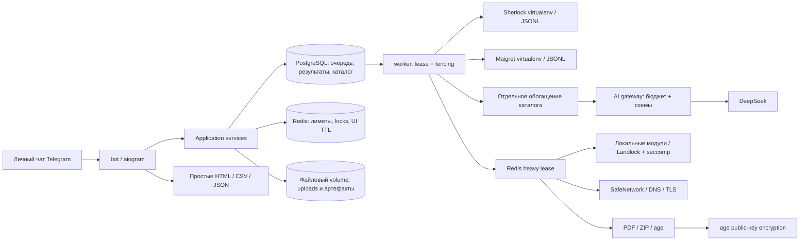

# Архитектура

Python 3.12; aiogram 3 для polling; PostgreSQL + SQLAlchemy async + Alembic; Redis для распределённых ограничений и кратких UI-состояний; HTTPX без скрытых повторов; Jinja2; ReportLab; стандартная age CLI.

`domain.py`: валидация, статусы и нормализация. `engines.py` + `engines/runner.py`: структурированный протокол к настоящим библиотекам. `services.py`: владение, очередь, атомарные записи и удаление. `storage.py`: ORM. `catalog.py` и `sources.py`: общий каталог и проверенные сетевые загрузки. `ai.py`: единый ограниченный gateway и контракты. `presentation.py`, `i18n.py`, `data/locales.json`: представление. `telegram.py`: handlers. `export.py`: отчёты. `worker.py`: фоновые циклы. `admin.py`: агрегаты.

Расширение использует те же Job/User/очередь: `kind` различает search/module/export/folder_export/compare; `module_id`, versioned `result` и обезличенные `metrics` дополняют модель. `modules.py` + `tools/runner.py` + `tools/sandbox.py` задают контракт и изоляцию шести модулей. `resources.py` — общий распределённый слот, `tasks.py` — dispatcher, `files.py` — квоты/владение/хэши, `workspaces.py` — ручные папки, `comparison.py` — сравнение, `packages.py` — manifest и изолированная упаковка. `tools_ui.py` подключён к существующему aiogram Router; RU/EN строки в `modules-locales.json`. Отдельных broker, AI gateway или постоянных сервисов модулей нет.

`journeys.py` объединяет выбор цели, явные переходы между модулями, предложение недавних собственных результатов, подборки карточек и выбор причины ошибочного совпадения. `coverage.py` считает реальные наблюдения движков и известную часть плана, одинаково для UI и отчётов. RU/EN строки — `journeys-locales.json`. Миграция `65e27c129abc` добавляет nullable reason/reviewed_at в Annotation, сохраняя прежние отметки и неизменные Check.

Checkbox-состояния изменяются под блокировкой User и generation; конечный batch save блокирует User/Workspace/Job, валидирует все ключи и вместимость, затем пишет всю подборку. Opaque request key в JSON каждого материала обеспечивает идемпотентность повторного подтверждения под блокировкой папки. Переходы QR/паспорт берут URL из собственной сохранённой задачи, повторно валидируют его и создают только подтверждаемый draft; сетевые запросы остаются в прежнем worker/SafeNetwork.

## Надёжная очередь

Очередь находится в PostgreSQL: это устраняет рассинхронизацию между отправкой сообщения брокеру и созданием задачи. Переходы `QUEUED → RUNNING → COMPLETED | PARTIAL | FAILED | CANCELLED`. Запись `queue_gate` сериализует приём задач и соблюдение глобальных лимитов. Worker выбирает запись с `FOR UPDATE SKIP LOCKED`, выдаёт уникальный lease token и продлевает аренду. Каждое сохранение проверяет токен, срок аренды, отмену, TTL и generation пользователя под блокировкой задачи.

После падения worker новая доставка сохраняет ранее записанные проверки и пропускает их. Уникальный индекс `(job_id, engine, site_key)` исключает дубли. После максимального числа доставок выдаётся PARTIAL либо FAILED. Платформа, URL и наблюдение каждого движка сохраняются отдельно; объединение не теряет происхождение. Новые задания не создаются повторно из одного draft; повтор ошибок идемпотентен относительно родительской задачи.

Новые задачи занимают тот же RUNNING gate и общий Redis heavy lease с TTL/heartbeat. Сохранённый module result предотвращает повтор обработки при redelivery; отсутствующий JSON-артефакт восстанавливается. Несохранённые outputs перед новой попыткой удаляются. Вложенная генерация PDF/ZIP не захватывает второй слот. Публикация файлов также проверяет lease и generation; все snapshots/скачивания требуют владения и TTL. [Подробности изоляции, хранения и очистки](modules.md).

Отмена обнаруживается heartbeat не позднее следующего цикла (обычно до 5 секунд); дочерний process group завершается, временный каталог удаляется. При завершении процесса приложения аренда истекает, и задача восстанавливается. Обогащение имеет независимое состояние и не влияет на завершение поиска.

## Изоляция движков

Разные virtualenv с хэшированными lock-файлами. Отдельный subprocess на движок/задачу, аргументы списком, ник передаётся JSON через stdin и никогда не становится CLI-флагом. Каждый процесс получает приватный временный каталог и минимальное окружение без токенов и DSN. Ограничены память, открытые файлы, время, размер протокола и контейнер; stderr upstream не публикуется и не логируется. Основная поддерживаемая среда — Linux Compose; Windows предназначен для разработки.

JSONL сообщает действительное число выбранных площадок, разрешение на запрос к хосту и каждое готовое наблюдение. Родитель применяет распределённый интервал Redis. При потере Redis новые разрешения не выдаются. Адаптер не классифицирует аккаунты самостоятельно: сохраняет upstream-статус, правило и HTTP-метаданные, затем консервативно понижает ненадёжные ответы.

Общий каталог не содержит пользовательские ники, Telegram ID или заметки. Только явно заданные алиасы объединяют домены. Для остальных сохраняется полный hostname с учётом private suffixes PSL; пути и query остаются значимыми, регистр пути не меняется.
